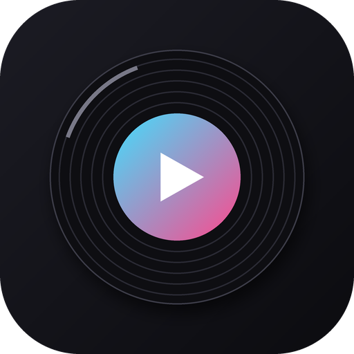
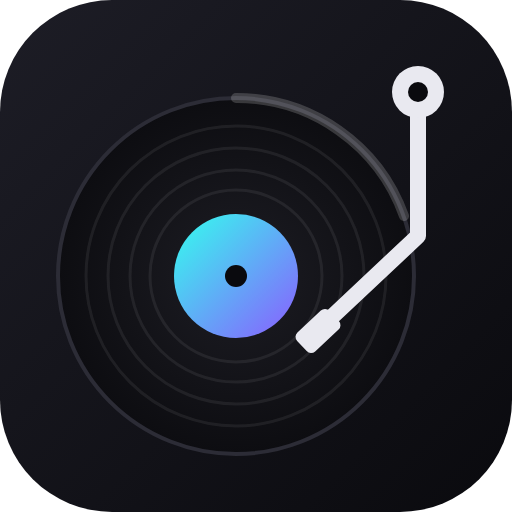
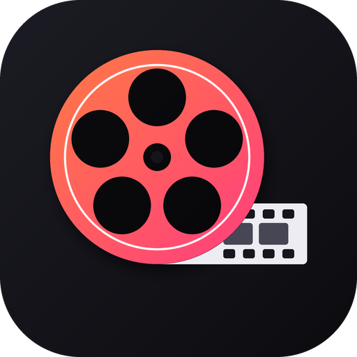
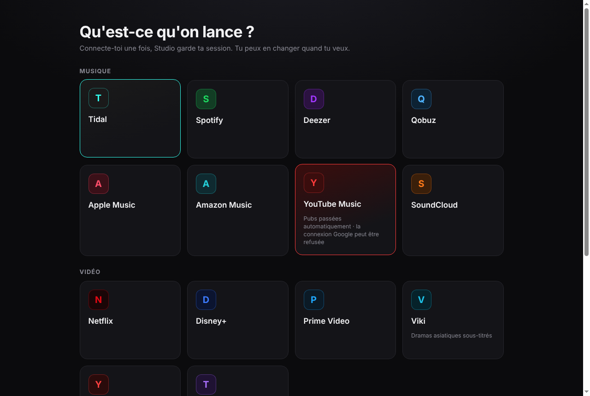

<p align="center">
  
  
  
</p>

<h1 align="center">Studio · Platine · Pellicule</h1>

<p align="center">
  Tes plateformes de musique, de vidéo et X dans des applis Windows stables.<br>
  Choisis celle qui te va : <b>tout en un</b>, ou juste ce qu'il te faut.
</p>

| | Appli | Contenu | Télécharger |
| --- | --- | --- | --- |
|  | **Studio** | Tout : musique, vidéo et réseaux, rangés en sections | [Dernière version](https://github.com/BlancheLaGoat/studio/releases/latest) |
|  | **Platine** | La musique : Tidal, Spotify, Deezer, Qobuz, Apple Music, Amazon Music, YouTube Music, SoundCloud (+ YouTube, Twitch) | [Dernière version](https://github.com/BlancheLaGoat/platine/releases/latest) |
|  | **Pellicule** | La vidéo : Netflix, Disney+, Prime Video, Viki, YouTube, Twitch, X | [Dernière version](https://github.com/BlancheLaGoat/pellicule/releases/latest) |

Les trois peuvent être installées en même temps : chacune garde ses propres connexions et réglages.

<p align="center">
  
</p>

## Ce qu'elles font

Chaque appli fait tourner le **site officiel** de chaque plateforme, avec le module DRM Widevine : musique en qualité **High / Max**, films et séries protégés, ton compte et ta bibliothèque. Une session par plateforme, donc tu restes connecté partout.

**Dans toutes les applis**
- **Bouton Accueil**, **Retour / Suivant / Actualiser**, **mode onglets** optionnel avec onglets détachables dans leur propre fenêtre, et plusieurs onglets YouTube, Twitch ou X.
- **YouTube sans pubs** (son coupé, accéléré, clic automatique sur « Passer ») et **Twitch sans pubs** ([TwitchAdSolutions](https://github.com/pixeltris/TwitchAdSolutions), MIT).
- **Lecture / pause** dans la barre et dans l'aperçu de la barre des tâches, touches multimédia.
- **Ne plante plus** : une page qui crashe ou fige est relancée là où tu étais ; une page de connexion ou un cache abîmé est réparé tout seul.
- **Discord**, **mises à jour automatiques**, **lancement au démarrage de Windows** (l'appli s'ouvre sur l'accueil : aucun live ni vidéo ne démarre tout seul ; option « Rouvrir mes onglets au lancement » dans le menu de l'icône).
- **Sécurité** : tes mots de passe ne passent jamais par l'appli (tu te connectes sur les vraies pages des sites) et aucune donnée n'est envoyée ailleurs.

**Musique (Platine, Studio)**
- **Mini-lecteur** (`Ctrl + Maj + M`), **overlay OBS**, **Playlists** Tidal / Spotify avec transfert et sauvegarde (`Ctrl + Maj + L`).
- La musique continue quand tu changes d'onglet ou fermes la fenêtre.

**Vidéo (Pellicule, Studio)**
- **Mode flottant** (`Ctrl + Maj + F`) : petite vidéo toujours au premier plan, même avec Netflix et Disney+.
- **Plein écran** du lecteur ou de l'appli (`F11`).
- **Pause automatique** de la vidéo quand tu changes d'onglet ou fermes la fenêtre (désactivable).

Qualité vidéo : comme dans Chrome, **HD, pas de 4K ni de HDR** sur Netflix, Disney+ et Prime Video (réservés à leurs applis officielles).

## Installation

1. Télécharge le `…-Setup-x.y.z.exe` de l'appli de ton choix (tableau ci-dessus).
2. Si Windows affiche **« Windows a protégé votre ordinateur »** : **Informations complémentaires** → **Exécuter quand même** (message normal pour une appli sans certificat Microsoft payant).
3. Choisis ta plateforme et connecte-toi.

---

## Pour les développeurs

Un seul code fabrique les trois applis. Les différences (plateformes, fonctions, réglages par défaut, icône, dépôt de publication) sont décrites dans `src/editions.js`.

```
npm install
python -m castlabs_evs.vmp sign-pkg node_modules/electron/dist
npm start                 # Studio
npm run start:platine     # Platine
npm run start:pellicule   # Pellicule
```

`npm run start:platine` utilise le même dossier de données que Platine installé (tu y retrouves tes connexions) : ferme d'abord Platine installé, sinon c'est lui qui s'affiche.

- `npm run dist:all` (ou `dist`, `dist:platine`, `dist:pellicule`) construit les installeurs dans `dist/<appli>/`, signés par Castlabs (compte EVS gratuit).
- **Ajouter une plateforme** : une entrée dans `src/platforms.js` (avec son `kind` : `music`, `video` ou `social`), puis son id dans les éditions voulues de `src/editions.js`.
- **Publier une version** : change `"version"` dans `package.json`, commit, push, puis tag `vX.Y.Z`. GitHub Actions construit les trois applis et publie chacune dans son dépôt (`platine`, `pellicule`, `studio`). Secrets de ce dépôt : `EVS_ACCOUNT`, `EVS_PASSWD` et `RELEASE_TOKEN` (jeton GitHub avec le droit *Contents : Read and write* sur les trois dépôts).

Construit avec [Electron for Content Security (Castlabs)](https://github.com/castlabs/electron-releases), [electron-builder](https://www.electron.build/) et [@xhayper/discord-rpc](https://github.com/xhayper/discord-rpc). Ces applis ne sont affiliées à aucune des plateformes citées.
